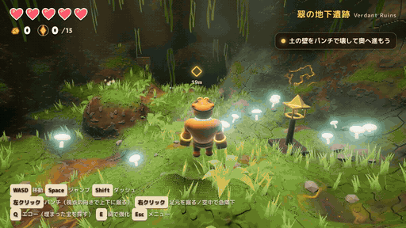

# GORO DIG — 地底のこぶし

**[▶ ゲームをプレイ（GitHub Pages）](https://onego15.github.io/bananza-claude/)**　｜　PC ブラウザ（Chrome / Edge / Firefox 推奨）、キーボード＋マウスまたはゲームパッド



> 録画：実際のゲームプレイ（ヘッドレス Chromium + SwiftShader 上で、スクリプト入力によって操作したものをフレーム単位で収録）。MP4 版：[docs/demo.mp4](docs/demo.mp4)

## 概要

穴掘り名人の **ゴロ** が、自慢の拳で地底世界を殴り、掘り、切り開いていく三人称 3D アクションアドベンチャーです。
光を失いかけた地底の国「ルミナ」を舞台に、壁を壊して道を作り、床を掘り抜いて下層へ降り、埋もれた太陽石や隠し部屋を探しながら、最奥の神殿に眠る巨像 **グラヴモウ** に挑みます。

「ドンキーコング バナンザ」の “地形を豪快に壊す気持ちよさ” に着想を得ていますが、キャラクター・マップ・音楽・デザインはすべてこのリポジトリのためのオリジナルです（外部の画像・3D モデル・音声ファイルは使っていません。全アセットはコードで手続き生成しています）。


## 特徴

- **地形を本当に壊せる**：壁・床・天井・柱を殴って掘れます。掘った跡はそのまま歩ける穴・トンネルになり、通常の地面と同じように当たり判定が働きます。下を向いて殴れば斜め下へ、上を向けば天井へ掘り進めます。
- **素材ごとの手応え**：土（よく削れる）／岩（やや硬い）／黒い硬岩（「大地の籠手」入手後のみ破壊可能）／輝晶（光る結晶が飛び散る）／金鉱（金貨がこぼれる）／レンガ（遺跡の壁）／古代石・岩盤（壊せない＝進行不能を防ぐ“背骨”）。素材によって削れる量・音・破片・粉塵の色が変わります。
- **破壊の気持ちよさ**：ヒットストップ、カメラシェイク、FOV キック、破片（インスタンス描画）、粉塵、衝撃リング、インパクトライト、素材ごとの効果音、ゲームパッド振動。
- **ゴロのアクション**：移動、ダッシュ（空中1回）、可変ジャンプ、3段パンチコンボ（3段目は大きく掘れる）、足元掘り、空中からの急降下パンチ（震脚の像で強化）、壁つかまり・よじ登り・壁ジャンプ、エコー（埋まった太陽石を探知）。
- **3つの地下エリア＋ボス**
  1. **翠の地下遺跡**：陽の差す陥没穴から始まるチュートリアル。3つのルーンストーン（1つは床下に埋まった部屋）を灯して古代の扉を開き、「大地の籠手」を入手、硬岩の床を砕いて下層へ。
  2. **輝晶の大空洞**：縦に広い結晶の大空洞。台地の上・硬岩に閉ざされた晶洞・檻の中の3つの輝晶灯を灯す。檻の上の岩棚を崩して大岩を落とす地形パズル。「震脚の像」を得て、封印石を急降下パンチで砕く。
  3. **陽の地底神殿**：溶岩の溝、レンガの壁、隠し金庫や屋根裏。最奥で大地の巨像 **グラヴモウ** と対決（拳の結晶を叩く→コア露出→3フェーズ）。撃破すると太陽核が再点火し、エンディングとリザルト（ランク S〜C）へ。
- **探索とやり込み**：各エリアに5個、計15個の太陽石（多くは土の中や隠し部屋に埋まっている）。5個ごとにハート+1。金で祠の強化（剛拳 Lv3／頑丈な体 Lv3）。
- **詰み防止**：先へ進むのに必要な場所は壊せない古代石で守り、どの方向から掘っても進行不能にならないよう設計。穴に落ちても壁を登って脱出でき、場外落下は直前の安全地点へ復帰（ハート-1）。大岩パズルは「掘って落とす」「殴って押し出す」のどちらでも解け、落ちた大岩が檻の近くに止まれば檻は必ず壊れます。
- **セーブ**：チェックポイント（祠）・エリア移動・定期オートセーブ。**掘った地形も保存**され、コンティニュー時に再現されます。
- **カメラ**：地形に対する球トレースで壁抜けを防止。狭い坑道では寄り、大空洞では引いて画角を広げ、縦穴では見下ろし気味に。カメラと主人公の間の岩はディザで透過（カットアウェイ）し、狭い場所でも主人公を見失いません。
- **グラフィック**：手続き 3D テクスチャによる地形シェーダー（地層・ひび割れ・苔・結晶・金脈・石積み・古代文様）、頂点 AO、影、ブルーム、霧、ACES トーンマップ、カラーグレーディング、風に揺れる草、ゴッドレイ、パーティクル。
- **サウンド**：WebAudio で全効果音を合成、洞窟リバーブ、エリアごとの BGM を生成的シーケンサーで演奏（音声ファイル不使用）。

## 操作方法

| 操作 | キーボード / マウス | ゲームパッド |
|---|---|---|
| 移動 | W A S D | 左スティック |
| カメラ | マウス（画面クリックでポインタロック） | 右スティック |
| ジャンプ（長押しで高く） | Space | A |
| ダッシュ（空中でも1回） | Shift | RB |
| パンチ（3連コンボ・カメラの向きに掘る） | 左クリック / F | X |
| 足元掘り / 空中で急降下パンチ | 右クリック / X | B / RT |
| エコー（埋まった宝を探知） | Q | Y |
| 祠で強化・調べる | E | LB |
| カメラを背後へ | R | スティック押し込み |
| メニュー | Esc / P | START |

壁に向かってジャンプすると壁にしがみつき、そのまま登れます。

## 起動方法

公開版：**https://onego15.github.io/bananza-claude/**

ローカル（Node.js 20 以上）：

```bash
npm ci
npm run dev        # http://localhost:5173/
npm run build      # dist/ に静的ファイルを出力（相対パスなのでどのサブパスでも動作）
npm run preview
```

デバッグ用 URL パラメータ：`?autotest&area=2&relics=gauntlet` で任意のエリアから開始（セーブはリセット）。`?capture` を付けると描画ループを止め、`window.__step(n, dt)` でフレームを決定論的に進められます（自動テスト・GIF 収録に使用）。

## 使用した AI サービスとモデル

- **AI サービス**：Claude（Anthropic）— Claude Code（クラウド実行環境、claude.ai のプロジェクトスレッドから起動）
- **モデル**：**Claude Opus 5.5**（モデル ID `claude-opus-5-5`、1M コンテキスト版 `claude-opus-5-5[1m]` として設定）。セッション情報 API の `configured_model` / `session_context.model` が `claude-opus-5-5[1m]`、`last_served_model` が `claude-opus-5-5` であることを制作中に確認しました。
- 企画・設計・コード・3D モデル（SDF から生成）・シェーダー・効果音・BGM・テスト・README まで、すべてこのモデルが作成しています。人間による画像・音声素材の追加はありません。

## 使用技術

- **three.js 0.186**（WebGL2 レンダラー、EffectComposer / UnrealBloomPass / OutputPass）
- **Vite 8**（開発サーバー・ビルド。`base: './'` でサブパス配信に対応）
- プレーンな JavaScript（ES Modules）。ゲームエンジンは使わず、物理・カメラ・AI・UI はすべて自作
- フォント：M PLUS Rounded 1c、Lilita One（いずれも SIL Open Font License、`@fontsource` 経由で同梱）
- テスト：Playwright（Chromium + SwiftShader によるヘッドレス WebGL）、Node.js
- デプロイ：GitHub Actions → `gh-pages` ブランチ → GitHub Pages

外部の 3D モデル・テクスチャ・音声ファイルは一切使っていません。キャラクターは SDF（符号付き距離関数）の組み合わせからメッシュ化し、テクスチャはシェーダー内で手続き生成、音は WebAudio で合成しています。

## 地形破壊システムの実装

1. **データ**：各エリアは 0.5 m 間隔のボクセル格子に **符号付き距離場（SDF、正＝空気）** と **素材 ID** を持ちます（例：エリア1は 129×73×169 点）。値は ±4 m でクランプ。
2. **生成**：`AreaBuilder` が部屋・トンネル・円柱（空気）、柱・箱・球（固体）、素材の鉱脈、後から刳り抜く穴、最後に置く栓（プラグ）を滑らかな min/max（smin/smax）とノイズ変位で合成して距離場を作ります。
3. **掘削**：パンチや急降下の衝撃は球で `f = max(f, r·h − |p−c| + noise)` と距離場を書き換えます（`h` は素材硬度：土 1.0／岩 0.74／輝晶 0.85／硬岩は籠手なし 0・あり 0.6／古代石・岩盤は 0）。削れた素材の量を集計し、破片の色・効果音・金貨のドロップ・粉塵に反映します。
4. **メッシュ化**：16³ ボクセルのチャンク単位で **Surface Nets**（双対等値面抽出）を行い、滑らかな面を生成。法線は距離場の勾配、素材は 8 種の重みを頂点属性に入れて混合、AO は距離場へのレイ探索で頂点に焼き込みます。掘削時は該当チャンクを即時に、周辺の AO は時間予算付きで遅延再構築します。
5. **見た目**：`MeshStandardMaterial` を `onBeforeCompile` で拡張し、ワールド座標の 3D ノイズ・セルラーノイズで素材ごとの模様と凹凸（バンプ）を計算。上向き面には苔。カメラと主人公の間はベイヤーディザで透過します。
6. **当たり判定**：プレイヤーと敵は距離場を直接サンプリングした 3 つの球で押し出し（サブステップ付き）。三角形メッシュとの衝突を使わないため、掘った直後でも判定がずれません。床へのスナップ、壁つかまり、めり込み時の脱出処理、最後の安全地点の記録を備えます。
7. **保存**：掘削は `[x, y, z, 半径, 威力, 籠手]` の列として保存し、ロード時に再適用して地形を再現します。

## 制作日時

| 項目 | 日時（UTC） | 日本時間（JST） |
|---|---|---|
| 制作開始（依頼メッセージ受信） | 2026-10-25 15:09:51 | 2026-10-26 00:09:51 |
| 制作終了（最終コミット時点） | <!--END_UTC--> | <!--END_JST--> |
| 経過時間 | <!--ELAPSED--> | |

時刻は作業環境の `date -u`、依頼メッセージのタイムスタンプ、git のコミット日時で確認しています。

## 実施したテストと結果

テストはすべて実際のブラウザ（Playwright + Chromium、GPU なし環境のため WebGL は SwiftShader によるソフトウェア描画）でゲームを起動して行いました。`?capture` モードで描画ループを止め、1/30 秒ずつ決定論的にフレームを進めながらスクリプト入力（`input.virtual`）で操作し、各段階のゲーム状態とスクリーンショットを確認しています。

| テスト | 内容 | 結果 |
|---|---|---|
| 移動・ジャンプ・パンチ | 歩行、ジャンプ、3段コンボ、ダッシュ、急降下パンチの各状態遷移 | ✅ 合格 |
| 壁の破壊・トンネル貫通 | エリア1 チュートリアルの土壁をパンチで掘り抜き、トンネルを通ってホールへ到達（デモ GIF の内容そのもの） | ✅ 合格 |
| 床・天井の破壊 | 足元掘りで縦穴を掘る／床下に埋まった部屋（ルーン R3）へ掘り下りる／上を向いて天井を掘る | ✅ 合格 |
| 掘削後の当たり判定 | 掘った穴の中を歩く・登る・落ちる。めり込み・すり抜けなし | ✅ 合格 |
| 穴の縁で浮く不具合 | エリア2 の封印穴の縁で主人公が空中に留まる不具合を発見 → 距離場の生成を修正し、落下して次エリアへ遷移することを確認 | ✅ 修正済み |
| 場外落下 | 主人公を地形の外（y=−3）へ移動 → 直前の安全地点に復帰、ハート −1 | ✅ 合格 |
| 死亡・リトライ | HP 0 → 「ゴロはたおれた…」画面 → もう一度 → チェックポイントで HP 全快で再開 | ✅ 合格 |
| セーブ・コンティニュー | 掘削後にセーブ → タイトルへ戻り「つづきから」→ 掘った地形が再現されている（距離場が空気になっている）ことを確認 | ✅ 合格 |
| エリア遷移 | 1→2（遷移処理）、2→3（封印を急降下パンチで砕いて縦穴へ落下） | ✅ 合格 |
| エリア1 進行 | 土壁 → ルーン3つ → 古代の扉 → 大地の籠手 → 硬岩の床 | ✅ 合格 |
| エリア2 進行 | 輝晶灯3つ（台地／硬岩の晶洞／檻）→ 大岩パズル → 扉 → 震脚の像 → 封印 | ✅ 合格（大岩パズルが発動しない不具合を修正後） |
| エリア3・ボス | 神殿を進みレンガ壁を破壊 → ボス起動 → 自動操作ボットで 3 フェーズ・コア 9 ヒットで撃破 → 太陽核再点火 → THE END 画面 | ✅ 合格 |
| 詰み防止 | 進行に必要な構造は破壊不可素材で保護。大岩は「掘る」「押す」どちらでも落ち、檻付近で止まれば檻は必ず壊れる | ✅ 合格（設計＋上記テスト） |
| 大量掘削の負荷 | `node tests/perf-terrain.mjs`：各エリアでランダムに 400 回掘削し再メッシュ化 | ✅ 下表 |
| サブパス配信 | `dist/` を `http://localhost:4173/bananza-claude/` 配下で配信し、`tests/live-check.cjs` を実行：全リクエスト成功・ページエラー 0・タイトル表示・「はじめから」でゲーム開始・パンチで地形が掘れる | ✅ 合格 |
| GitHub Pages 公開先 | <!--LIVE--> | <!--LIVE_RESULT--> |

**大量掘削の負荷テスト結果**（作業環境の CPU、Node.js 22。地形 1 回の掘削＋影響チャンクの再メッシュ化にかかる時間）

| エリア | 格子 | 初期三角形数 | 400 回掘削後 | 掘削 1 回（中央値 / 95% / 最大） | 掘削が正しく空気になった割合 | NaN |
|---|---|---|---|---|---|---|
| 1 | 129×73×169 | 71,084 | 522,760 | 15.6 / 34.6 / 52.0 ms | 400/400 | 0 |
| 2 | 145×105×153 | 132,616 | 639,640 | 15.1 / 31.4 / 44.1 ms | 400/400 | 0 |
| 3 | 121×89×193 | 72,212 | 601,820 | 14.0 / 30.7 / 60.8 ms | 400/400 | 0 |

※ 地形の内部にランダムに空洞を作る極端な条件のため三角形数が大きく増えます。通常のプレイでの増加はこれよりずっと小さくなります。

**FPS について**：作業環境には GPU がなく、ソフトウェア描画（SwiftShader）では 1280×720 で 1 フレーム約 70 ms（約 14 FPS）でした。これは GPU を使った実機の性能を表すものではないため、**実機（GPU あり）での FPS は未確認**です。ゲームには直近の平均フレーム時間に応じて描画解像度を自動調整する仕組みを入れています。

## グラフィック・UI・ゲーム性について改善した内容

実際にブラウザで動かしてスクリーンショットを確認し、見つけた問題を以下のように直しました。

- **主人公**：腕と拳が描画されないバグ（SDF カプセルの引数ずれで NaN）を修正。お腹の模様のギザギザを滑らかに。リムライトを弱めて質感を自然に。
- **草**：両面描画で法線が裏返り真っ黒に見えていた → 葉の法線を固定して自然な緑に。サイズと密度も調整。
- **カメラ**：トンネル内で頭の真後ろまで寄ってしまう問題 → 最低距離 3 m を保ち、岩の中にカメラが入った場合は裏面カリング＋カットアウェイで主人公を見せる方式に。
- **破片・粉塵**：大きすぎ・明るすぎた破片とインパクト光を縮小・減光し、地形の形が見えるように。
- **古代石**：「SF 的なグリッドとアルファベット」に見えていたシェーダーを、面取りした石積みと控えめなルーン文様に作り直し。
- **輝晶の大空洞**：平坦で発光しすぎの結晶装飾を、根元が暗く先端だけ光る六角柱の群晶に作り直し。水玉模様に見えた結晶鉱・金鉱を、刃状の結晶と細い金脈に変更。全体の彩度とブルームを下げた。
- **ボス**：ノイズの斑点模様だった体を、玄武岩の地肌＋苔＋太い溶岩の亀裂に。コアへのヒット時の白飛びを抑えた。
- **パズル**：大岩が棚の上で止まって檻を壊せない問題 → 押すと岩棚にひびが入って真下に落ち、檻で砕け散るように。
- **タイマー**：演出の終了を `setTimeout`（実時間）で行っていたため、ポーズ中や処理落ちで操作不能が続く問題 → ゲーム内時間のタイマーに置き換え。
- **配置**：浮いたり埋まったりしていた小物を地形の表面に自動で接地。トンネルをふさいでいた看板を移動。
- **メモリ**：エリア切り替え時に GPU リソースを完全に解放するように（繰り返しのエリア移動でのブラウザのクラッシュ対策）。
- **UI**：エンディング画面が 720p で下が切れていたのを調整。favicon を追加。


## 既知の問題・未完成部分

- **実機 GPU での FPS は未確認**です（作業環境に GPU がなく、ソフトウェア描画でしか動作確認できていません）。
- **実際の人間によるプレイテストは行っていません**。操作感・難易度・クリア時間（目安 15〜30 分を想定して設計）は自動テストと設計上の見積もりであり、**実プレイでのクリア時間は未確認**です。自動テストのボス戦は、ボットが弱点の近くへ瞬間移動して攻撃する方式のため、通常操作でのボス戦の難しさは検証できていません。
- 掘削 1 回あたり 15 ms 前後（作業環境の CPU で測定）の再メッシュ処理が走るため、低性能 PC では掘った瞬間に軽いカクつきが出る可能性があります（ヒットストップ演出で目立ちにくくしています）。
- 地形内部にたくさん空洞を掘ると三角形数が増え、描画負荷が上がります。
- Safari・スマートフォン（タッチ操作）での動作は未確認です。タッチ操作には対応していません。
- 効果音・BGM はブラウザ上で合成しているため、ヘッドレス環境では音の聞こえ方を確認できていません（**音の品質は未確認**）。
- デモ GIF はソフトウェア描画で 1 フレームずつ撮影したもので、実機より解像度・フレームレートを落としています。

## 制作に使用したプロンプト全文

ユーザーからの依頼文 2 通を、本文・箇条書き・番号を含めて改変せずに掲載します（同じ内容を [docs/PROMPT.md](docs/PROMPT.md) にも置いています）。

<details>
<summary>クリックで全文を表示</summary>

ユーザー（くわ）から受け取った依頼文を、改変せずにそのまま掲載しています。

### メッセージ 1（2026-10-25 15:09:51 UTC）

```text
前回のものは捨てて新しく作り直します。

ドンキーコング バナンザに着想を得た、地形破壊を中心とする3Dアクションアドベンチャーゲームを制作してください。
ブラウザで快適に遊べる、商業インディーゲームのような完成度を目指してください。
最も重視するのは、地形を豪快に破壊する爽快感、美しく作り込まれた3Dグラフィック、魅力的なキャラクター、未知の地下世界を探索する冒険感、優れたカメラワークと操作感です。
今回は特に、十分な時間と労力をかけて作品を磨き上げてください。動くプロトタイプが完成しただけで作業を終了しないでください。
1. ゲームのコンセプト

* 三人称視点の3Dアクションアドベンチャー
* 主人公は強力なパンチや身体能力を持つオリジナルキャラクター
* 壁や床、岩などを破壊して自由に道を切り開く
* 地下世界を探索し、隠された宝物や新しいエリアを発見する
* 戦闘、探索、収集、ギミックを組み合わせる
* 15〜30分程度で一通りクリアできる規模を目指す

2. 地形破壊システム（最重要）
単に配置されたブロックを消すだけではなく、地形そのものを削ったり、穴を開けたり、トンネルを掘ったりできる仕組みを目指してください。

* パンチで壁や岩を破壊できる
* 地面を掘って下の空間へ進める
* 壁をくり抜いてトンネルを作れる
* 破壊した形状が地形に反映され、内部にも移動できる
* 土、岩、鉱石など、材質によって硬さや破壊演出が異なる
* 破壊した場所から宝物や隠された通路が現れる
* 破壊時の破片、粉塵、衝撃波、効果音、画面揺れで爽快感を生み出す

内部データにボクセルを使用しても構いませんが、見た目まで単純な立方体の集合にする必要はありません。
滑らかな地形表面と自然な造形を重視し、技術的に実現可能な最良の破壊システムを設計してください。
3. キャラクター・アクション

* 個性的で魅力のあるオリジナルの3D主人公
* 歩行、ダッシュ、ジャンプ、パンチ、空中攻撃
* 攻撃時に力強いモーションと明確なヒット感がある
* 地形破壊と戦闘のアクションが自然につながる
* 敵キャラクターにも独自の外見とアニメーションを用意する
* 操作の応答性がよく、思いどおりに動かせる
* 地形の凹凸や破壊後の穴でも移動が破綻しない

3Dモデルやアニメーションの品質を重視してください。コードだけで十分な品質を実現できない場合は、利用条件を遵守した高品質な公開アセットの活用も検討してください。
4. ステージ・冒険
複数の特色ある地下エリアを制作してください。
例：

* 緑豊かな地下遺跡
* 鉱石が輝く巨大洞窟
* 古代文明の眠る地底神殿

ただし、エリア数よりも密度と完成度を優先してください。

* 高低差のある立体的なマップ
* 地形を破壊することで発見できる秘密
* 地形破壊を活用した簡単な謎解き
* 宝物の収集と能力強化
* 印象的なギミックやボス戦
* 導入からエンディングまで遊べるゲーム進行

プレイヤーが想定外の方向から地形を破壊しても、可能な限りゲーム進行が破綻しないようにしてください。
5. グラフィック・アートディレクション
今回、グラフィック品質は地形破壊の技術と同じくらい重要です。

* 商業インディーゲームのような美しい3D世界
* 統一感のある色彩、造形、テクスチャ、ライティング
* キャラクターや敵は簡素な基本図形の組み合わせで完成扱いしない
* 地形には自然な凹凸や細かな装飾を用意する
* 植物、岩石、遺跡、鉱石などで世界に密度を持たせる
* 光、影、ブルーム、霧、パーティクルなどで豊かな空気感を表現する
* 破壊前後の地形が視覚的に自然につながる
* UI、効果音、BGMも世界観に調和させる

技術デモや試作品のような見た目ではなく、スクリーンショットを見ただけで遊びたくなる作品を目指してください。
6. カメラワーク・UI/UX

* 三人称カメラで主人公を自然に追従する
* 攻撃や地形破壊の際には適切なカメラ演出を行う
* 狭い洞窟でも壁に視界を遮られないようにする
* 地下へ掘り進む際にも主人公と周囲を見やすくする
* 大きな空間に出たときはカメラでスケール感を伝える
* 直感的な操作説明と分かりやすいUI
* 収集状況や目的地が自然に理解できる
* カメラ演出の派手さよりも操作性と視認性を優先する

7. 技術選定

* ブラウザで遊べることを必須とする
* ゲームエンジン、フレームワーク、プログラミング言語は自由
* 必要ならWebGLやWebGPU、ボクセル地形、独自シェーダーなどを利用してよい
* 外部アセットはライセンスを遵守して利用可能
* パフォーマンスと地形破壊の自由度のバランスを考慮する
* 原作のキャラクター、音楽、マップ、固有デザインはコピーせず、オリジナル作品とする

8. 品質改善・自律制作（最重要）
基本的なゲームが動くようになっても、そこで完成と判断しないでください。
初期実装後に、グラフィック、キャラクターアニメーション、地形破壊、カメラ、操作感、ゲームバランスを改善する工程を必ず設けてください。

* 実際にブラウザで起動し、スクリーンショットやプレイ映像を確認する
* グラフィックが簡素な場合は、アセット、モデリング、ライティング、描画処理を改善する
* 地形破壊の気持ちよさを繰り返し検証する
* 主人公の移動と攻撃が快適になるよう調整する
* 問題の発見、修正、再テストを繰り返す
* 制作速度よりも最終品質を優先する
* 可能な限り、利用可能な作業時間を品質改善にも十分に活用する
* コンテンツ量を増やすより、完成度の高い体験を優先する

特に、見た目が簡素な状態や、地形破壊が物足りない状態で完成と判断しないでください。
私への途中確認や質問は不要です。利用可能なツール・作業時間・実行予算の範囲で自律的に制作してください。
9. テスト・品質保証
可能な限り実際にプレイし、以下を検証してください。

* 通常移動、ジャンプ、パンチが正常に機能する
* 壁・床・天井を破壊できる
* 破壊後の地形に適切な当たり判定が反映される
* トンネルを掘って通り抜けられる
* 地形破壊後にキャラクターが埋まったり落下し続けたりしない
* 大量の地形破壊後も快適なフレームレートを維持する
* 想定外の方向から探索しても進行不能にならない
* リトライ、セーブ、ステージ遷移が正常に機能する
* ゲーム開始からエンディングまで到達できる

単純な操作だけでなく、連続した地形破壊や特殊な角度からの攻撃など、境界条件も検証してください。
10. GitHub README・制作記録
README.mdには次の内容を含めてください。

1. ゲームタイトルと概要
2. 実際のゲームプレイを録画した10〜15秒程度のGIFアニメーション
   * `docs/demo.gif` に配置してREADME冒頭に埋め込む
   * 主人公のアクション、地形破壊、冒険シーンを収録
   * 可能ならMP4動画も保存する
3. ゲームの特徴・操作方法
4. 起動方法
5. 使用したAIサービス名と正確なモデル名
6. 使用技術・ゲームエンジン
7. 地形破壊システムの実装方式
8. 制作開始・終了日時と経過時間
9. 実施したテストと結果
10. グラフィック・UI・ゲーム性について改善した内容
11. 制作に使用した、この依頼プロンプトの全文
12. 既知の問題と未完成部分

GIFは実際のゲームプレイを録画したものを使用してください。架空のプレイ動画で代用しないでください。
モデル名、制作時間、テスト結果など、確認できない情報は推測せず「未確認」と記載してください。
11. 完成条件

* ブラウザで正常にプレイできる
* 地形を破壊して新しい道を作れる
* 破壊と探索がゲームの中心的な楽しさになっている
* キャラクター、地形、エフェクトが視覚的に完成された品質である
* 気持ちのよい操作感とカメラワークを備える
* 最初から最後まで遊べる
* 品質改善とテストを実施している
* READMEとプレイGIFが用意されている

制約によって実現できなかった項目は、完成したと装わず正直に記録してください。
```

### メッセージ 2（2026-10-25 15:16:17 UTC）

```text
12. GitHub Pagesでの公開（必須）
完成したゲームをGitHub Pagesで公開し、ブラウザからすぐに遊べる状態にしてください。

* GitHub Pagesで動作する静的Webアプリとして構築する
* GitHub Actionsなどを利用して、ビルドとデプロイを自動化する
* リポジトリ名を含むサブパスで正常に動作するように設定する
* JavaScript、CSS、3Dモデル、テクスチャ、音声などのアセットが正しく読み込まれるようにする
* GitHub Pages上でもゲームの全機能が動作することを確認する
* READMEの冒頭に「ゲームをプレイ」リンクを掲載する
* ローカル環境だけでなく、公開先でも起動・描画・操作に問題がないことを検証する
* 公開に必要なGitHub側の設定や権限が不足している場合は、必要な手順をREADMEに明記する

公開URLは原則として以下の形式にしてください。
`https://onego15.github.io/<リポジトリ名>/`
ローカルで正常に動作するだけでは完成とせず、GitHub Pages上で実際に遊べることを最終目標としてください。
ただし、GitHubへのアクセス権限や実行環境の制約で公開できない場合は、公開完了と偽らず、デプロイ設定を準備したうえで残りの手順を明記してください。
最終成果物

* ブラウザで遊べるゲーム本体
* GitHub Pagesへのデプロイ設定
* 実際のプレイ動画を収録した `docs/demo.gif`
* GitHub PagesのプレイURLを掲載したREADME
* 制作プロンプト全文、使用モデル名、制作時間、テスト結果の記録

GitHub Pagesでの公開と公開先での動作確認まで、可能な範囲で自律的に進めてください。
```

</details>

## GitHub Pages の設定

`main` への push で `.github/workflows/pages.yml` が動き、ビルド結果を `gh-pages` ブランチへ発行し、公開されたページをヘッドレス Chromium で開いて動作確認します（スクリーンショットは Actions の成果物 `live-check` に保存）。

リポジトリの **Settings → Pages** は「Deploy from a branch」・ブランチ `gh-pages` / `(root)` で公開されます（今回は `gh-pages` ブランチの作成時に GitHub が自動で有効化しました）。フォークなどで自分の環境に公開する場合は次の手順です。

1. リポジトリを GitHub に push する（Actions が `gh-pages` ブランチを作成）
2. **Settings → Pages → Build and deployment** で Source を「Deploy from a branch」、Branch を `gh-pages` / `/ (root)` にして Save
3. **Settings → Actions → General → Workflow permissions** が「Read and write permissions」になっていることを確認（`gh-pages` への push に必要）
4. 数分後に `https://<ユーザー名>.github.io/<リポジトリ名>/` で遊べます。ビルドは相対パス（`base: './'`）なので、リポジトリ名を変えても設定変更は不要です。

## ライセンス

コード：MIT。フォント：SIL Open Font License 1.1（M PLUS Rounded 1c、Lilita One）。
